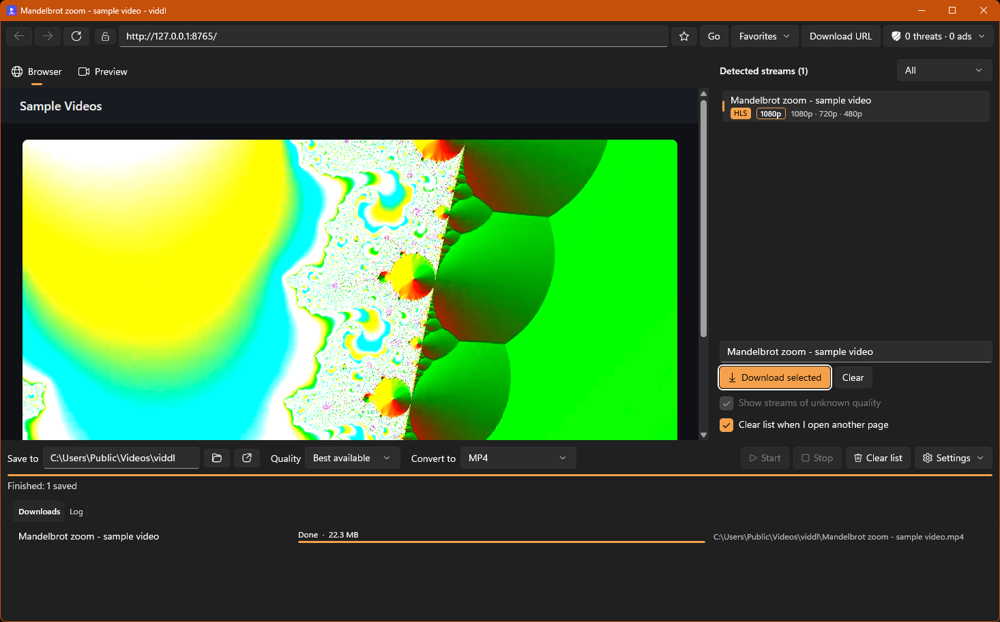
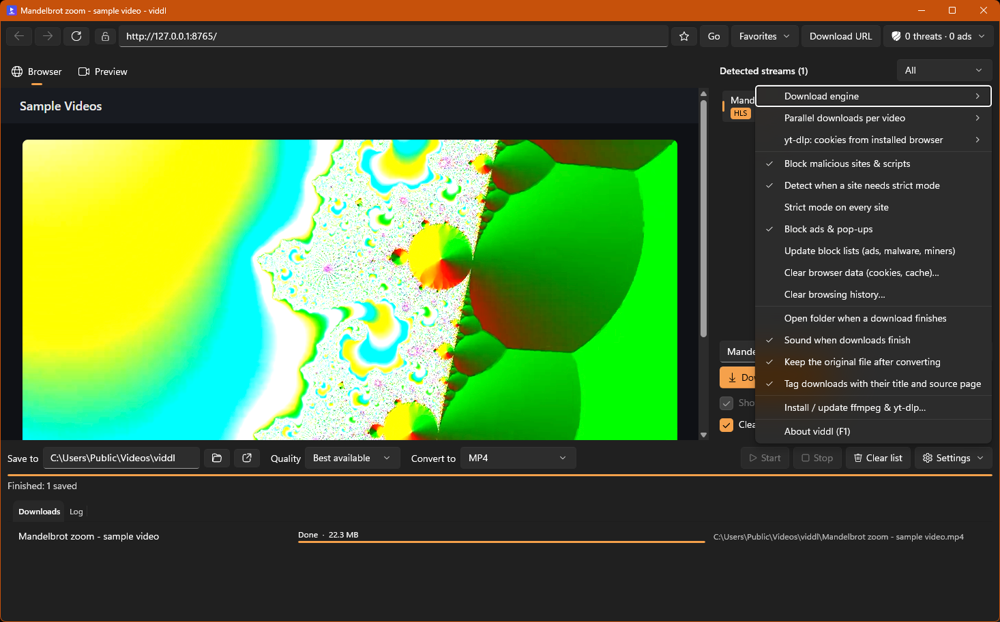
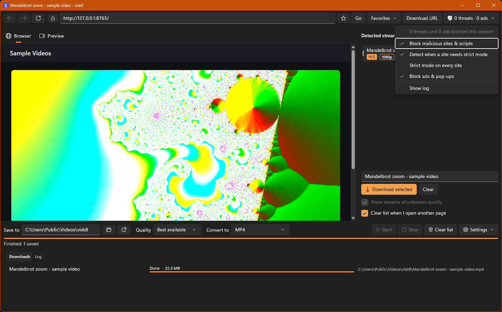

# viddl

viddl is a Windows desktop app for saving online videos as MP4 files. It has a built-in browser that
watches network traffic while a video plays, lists the streams it finds, and downloads the one you pick.
Downloads are saved as MP4 without re-encoding, or converted to another format if you prefer.

## Features

### Finding videos

- **Built-in browser** (Microsoft Edge WebView2) with back/forward/reload, an address bar that suggests
  favorites and recently visited sites, and a favorites menu.
- **Stream detection** while a video plays: HLS (`.m3u8`), DASH (`.mpd`) and whole video files. HLS entries
  show the available qualities or the running time; per-quality playlists are grouped under their master
  playlist so each video appears once.
- **Best quality first**: detected streams are sorted by resolution, with a filter to hide anything below a
  chosen quality (720p, 1080p...) and an option to hide streams whose quality is unknown.
- **Download URL**: paste a direct `.m3u8`, `.mpd` or `.mp4` link, or any page supported by yt-dlp.

### Downloading

- **Download engines**
  - HLS: picks a quality, downloads segments in parallel, decrypts standard AES-128, merges separate audio
    tracks and supports fragmented MP4. Live streams are recorded until stopped.
  - DASH: fetched and muxed by ffmpeg.
  - Whole files: saved directly (non-MP4 containers are remuxed).
  - Web pages: handed to yt-dlp, with a fallback that scans the page HTML.
- **Download queue** with steady progress, speed and time remaining, retry, and stop/resume. The newest
  download is listed first, and **Clear list** removes finished entries.
- **Quality choice**: best available, or a maximum such as 1080p or 720p.
- **Parallel downloads**: 1 to 16 connections per video.
- **Conversion**: keep the MP4 as downloaded, or convert it to MP4 (H.264/AAC, 720p or 480p), MKV,
  WebM (VP9/Opus), MP3 or M4A. The original can be kept alongside the converted file.
- **Preview**: double-click a download to watch it in the **Preview** tab, even while it's still downloading.
  Detected streams can be previewed before downloading too.
- **Video tags**: downloads are tagged with their title and the page they came from. Right-click a download
  and choose **Edit tags…** to set its title, description, comment, date and genre. Tags are written without
  re-encoding.
- **Tools on demand**: on first start (or whenever they're missing) viddl offers to download ffmpeg and yt-dlp
  for you.

### Staying safe

- **Browser protection**: blocks known malware, phishing and cryptomining domains, suppresses page dialogs and
  pop-ups, cancels downloads started by pages, denies permission prompts, and stops pages from launching other
  programs.
- **Strict mode, when it's needed**: viddl watches what each site tries to do (redirecting you elsewhere,
  loading known malicious content, starting downloads or other programs, pop-ups, dialog and permission spam,
  heavy advertising). When a site crosses the line, strict mode switches on for that site only, blocking
  third-party scripts and automatic cross-site redirects. A notice offers to reload the page or undo, and a
  **Strict** badge in the address bar shows whenever strict mode is active. Strict mode can also be turned on
  for every site.
- **Ad and tracker blocking** using a built-in list, optionally extended with a community hosts list.

### And more

- Light and dark themes that follow Windows.
- Settings, favorites and history stay on your PC (see [Where viddl keeps its files](#where-viddl-keeps-its-files)).
- Keyboard shortcuts for the common actions (see [Keyboard shortcuts](#keyboard-shortcuts)).
- Installer and portable versions for 64-bit, 32-bit and ARM PCs.

<table>
  <tr>
    <td></td>
    <td></td>
  </tr>
  <tr>
    <td align="center">Settings</td>
    <td align="center">Protection</td>
  </tr>
</table>

DRM-protected streams (Widevine, PlayReady, FairPlay, SAMPLE-AES) are detected, shown greyed out and never
downloaded. Only download videos you have the right to save.

## Download

Get the latest version from the **[releases page](https://github.com/edgeofsanity76/viddl/releases/latest)**.
Every release has an installer and a portable zip for each kind of PC:

| Your Windows | Installer | Portable |
|---|---|---|
| 64-bit (most PCs) | `viddl-<version>-win-x64.msi` | `viddl-<version>-win-x64.zip` |
| 32-bit | `viddl-<version>-win-x86.msi` | `viddl-<version>-win-x86.zip` |
| ARM (e.g. Snapdragon laptops) | `viddl-<version>-win-arm64.msi` | `viddl-<version>-win-arm64.zip` |

- **Installer:** installs for your user account only (no administrator rights needed) to
  `%LocalAppData%\Programs\viddl` and adds viddl to the Start menu. Uninstall it from **Settings → Apps**.
  Newer versions install over older ones.
- **Portable:** unzip anywhere and run `viddl.exe`.
- [All releases](https://github.com/edgeofsanity76/viddl/releases)

Both include everything viddl needs, so nothing else has to be installed. viddl runs on Windows 10 version 1809 or
later and Windows 11, and uses the Microsoft Edge WebView2 Runtime that comes with them.

If Windows shows **"Windows protected your PC"** when you start a build that isn't signed, click
**More info → Run anyway**. Signed releases show viddl as the verified publisher.

**First run:** viddl offers to download the two helper programs it needs: ffmpeg from
[BtbN/FFmpeg-Builds](https://github.com/BtbN/FFmpeg-Builds) and yt-dlp from
[yt-dlp/yt-dlp](https://github.com/yt-dlp/yt-dlp). They go into its data folder. If you skip this, click the
**Missing** note in the status bar or use **Settings → Install / update ffmpeg & yt-dlp** later. Copies already
on your `PATH` are used as well.

## Using viddl

1. Type an address or search terms in the address bar and press Enter.
2. Play the video. Its streams appear under **Detected streams**, newest first.
3. Select one or more streams, adjust the file name if you like, and click **Download selected**
   (or double-click a stream, or press Enter).
4. Follow progress under **Downloads**. Double-click an entry to preview it. Right-click it to play it, show it
   in its folder, convert it, edit its tags, retry it or remove it.

Choose **Quality** and **Convert to** in the bar above the downloads list before starting a download.

To download a link directly (an `.m3u8`, `.mpd` or `.mp4` URL, or a page supported by yt-dlp), paste it in the
address bar and click **Download URL**.

### Keyboard shortcuts

| Keys | Action |
|---|---|
| F5 | Reload |
| Alt+← / Alt+→ | Back / forward |
| Ctrl+L | Go to the address bar |
| Ctrl+D | Add or remove the current page from favorites |
| Enter (stream list) | Download the selected streams |
| Delete | Remove the selected streams or downloads |
| Esc | Stop the current download |

### Protection settings

The shield button in the address bar shows how many threats and ads were blocked. Its menu turns protection,
strict-mode detection, strict mode for every site and ad blocking on or off.

Strict mode is off by default. When a site behaves suspiciously, viddl switches it on for that site and shows a
notice; the **Strict · detected** badge then appears in the address bar while you're on that site. Hover over the
badge to see why, or click it to turn strict mode off for the site (viddl then won't switch it on there again).
When strict mode is on for every site, the badge reads **Strict**, and the menu can allow third-party scripts on
the current site if its video player doesn't work. **Settings → Update block lists** downloads the
[StevenBlack hosts](https://github.com/StevenBlack/hosts), [URLhaus](https://urlhaus.abuse.ch/) and
[NoCoin](https://github.com/hoshsadiq/adblock-nocoin-list) lists.

You can add your own domains, one per line, to `adblock-custom.txt` or `malware-custom.txt` in the data folder.

## Where viddl keeps its files

| Location | Contents |
|---|---|
| `%LocalAppData%\viddl\settings.json` | Settings, favorites, history, sites where strict mode was switched on, and exceptions |
| `%LocalAppData%\viddl\tools` | ffmpeg and yt-dlp |
| `%LocalAppData%\viddl\WebView2` | The browser profile (cookies, cache, sign-ins) |
| `%LocalAppData%\viddl\*.txt` | Downloaded and custom block lists |
| `%LocalAppData%\Programs\viddl` | The app itself, when installed with the installer |

Everything is kept locally on this PC (nothing roams with your Windows account), and a new installation starts with
default settings. Installing, upgrading or uninstalling never touches `%LocalAppData%\viddl`; delete that folder to
reset viddl completely.
